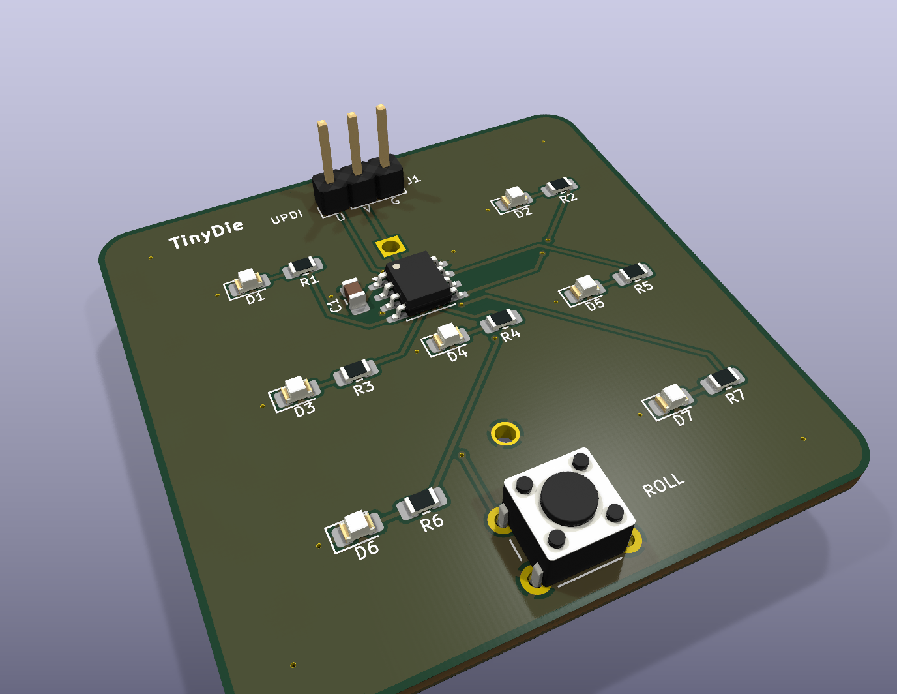
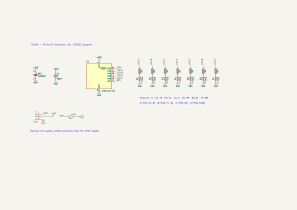
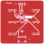
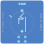
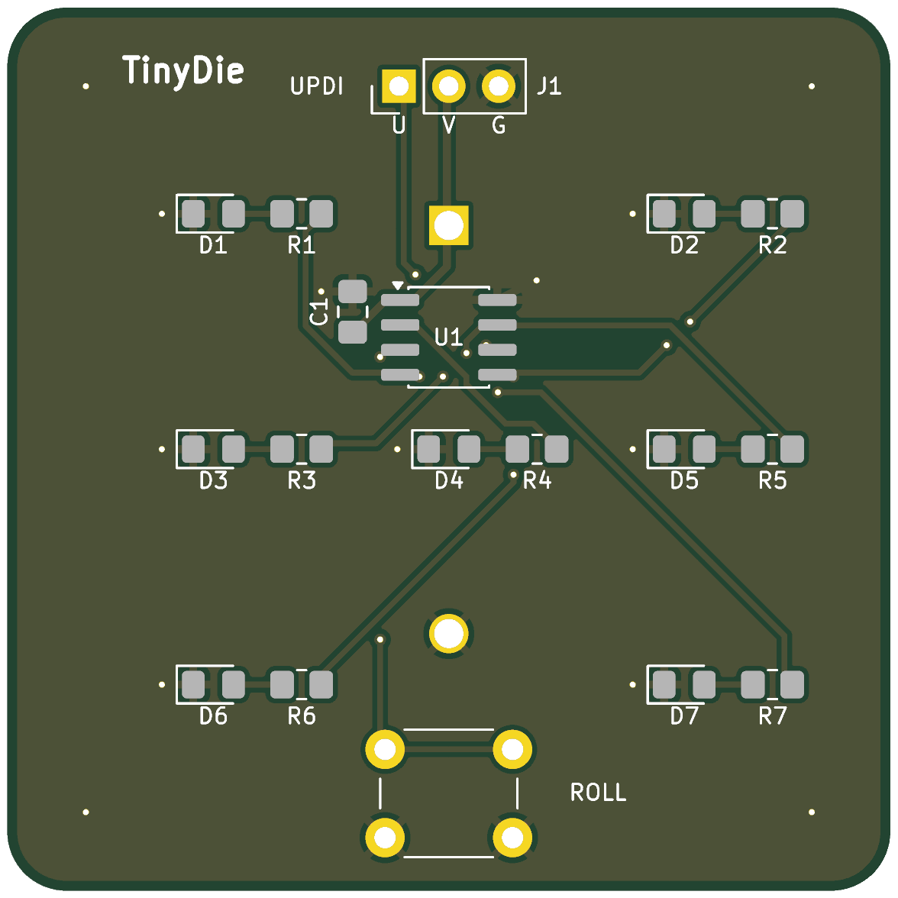
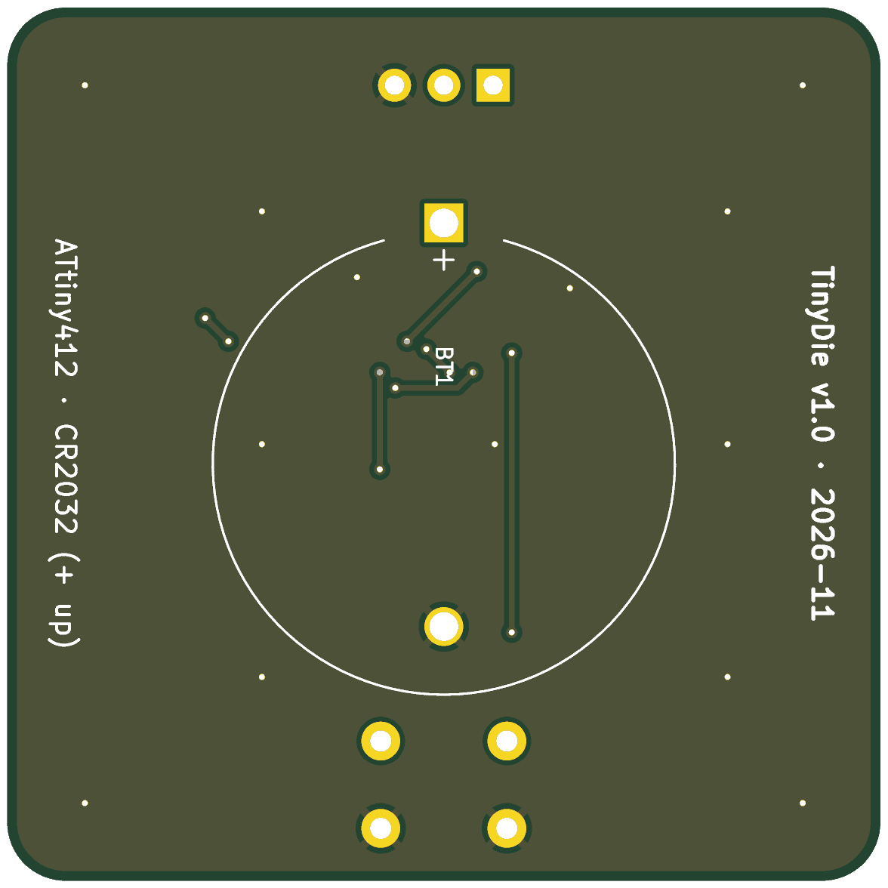
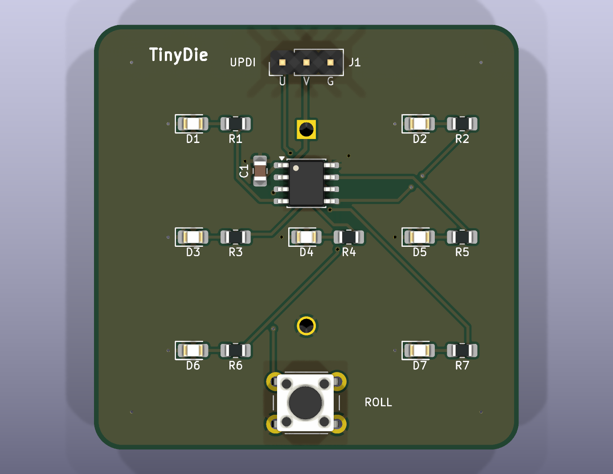

# TinyDie — Build Journal

How TinyDie went from a one-line brief to a board ready to send to a fab, step by step.



> **About the images:** all of them come from the files in `hardware/docs/`, rendered from the finished design.

---

## 1. The brief and picking a chip

The constraints were: an **8-pin microcontroller**, designed in **KiCad**, and **no more than $35** for all parts and boards.

I went with the **ATtiny412**:
- **6 usable I/O pins**, which is the most you get from an 8-pin package.
- **UPDI** single-wire programming. Any 3.3 V USB-serial adapter plus a 1 kΩ resistor can program it, so there's no dedicated programmer.
- An internal oscillator, so no crystal.
- **Power-down sleep at about 0.1 µA**, which makes a coin cell practical.
- It costs about $0.75.

## 2. The idea: an electronic die

A die face looks like 7 independent LEDs, but the pips always come in fixed pairs. That means only **4 LED groups** are needed:

| Group | Pin | LEDs | Lit on |
|---|---|---|---|
| A | PA1 | top-left + bottom-right | 2, 3, 4, 5, 6 |
| B | PA2 | top-right + bottom-left | 4, 5, 6 |
| C | PA3 | middle-left + middle-right | 6 |
| D | PA6 | centre | 1, 3, 5 |

The four groups take 4 pins, the **button** takes PA7 and **UPDI** takes PA0. All six I/O pins have a job and none are spare.

For power I picked a **CR2032**. The chip sleeps between rolls and a button press wakes it, so the board doesn't need a power switch.

## 3. Firmware (`firmware/main.c`)

I wrote it bare-metal against avr-libc, without the Arduino core:

- **Power-on self test:** shows each face 1–6 once.
- **Rolling:** while the button is held, a new random face appears every 50 ms.
- **Slow-down:** after release, the delay between faces grows by 25% each step until it reaches about 300 ms, then the die lands on its result.
- **Result:** shown for 4 s. Pressing the button during that time starts a new roll.
- **Sleep:** LEDs off, then power-down. A pin-change interrupt on PA7 (both edges) wakes the chip.
- **Randomness:** an xorshift16 generator. Every 50 ms while the button is held, the free-running TCA0 counter is XORed into it. Rejection sampling on 3 bits gives a fair 1–6.

**Problem:** Arch's `avr-gcc` couldn't find the avr-libc headers.
**Fix:** added `--sysroot=/usr/lib/avr -isystem /usr/lib/avr/include` to the Makefile. It's only applied when that directory exists, so builds on other systems aren't affected.

```
$ make
   text    data     bss     dec     hex filename
    447       2       0     449     1c1 tinydie.elf
```

That's 447 bytes of the 4 KB flash. I also added a `make flash` target that programs the chip over SerialUPDI with `pymcuprog`.

## 4. Schematic (`hardware/tinydie.kicad_sch`)

I generated the schematic with a Python script (`hardware/scripts/gen_sch.py`) instead of drawing it by hand. That way the netlist is defined in one place, and the script can rebuild the schematic after every change.

- I wrote `sexp.py`, a small S-expression reader and writer for KiCad's file format.
- Symbols are pulled from the stock KiCad libraries.
- `ATtiny412-SS` isn't a full symbol in the stock library. It's defined as an `extends` of `ATtiny202-SS`, so the script flattens the parent into the child before embedding it.
- Circuit: U1, 7 LEDs each with its own **330 Ω** resistor (about 3 mA per LED), **100 nF** decoupling on VDD, a 6 mm tact switch to GND, a 3-pin UPDI header (U/V/G), and the CR2032 holder.
- **Problem:** the first ERC run showed **58 "library not configured" warnings**. KiCad had never been launched on this machine, so the global `sym-lib-table`/`fp-lib-table` didn't exist.
  **Fix:** copied the stock tables into `~/.config/kicad/10.0/`. ERC dropped to **0**.
- I exported the netlist and compared it against the intended connections. It matched exactly.
- **Readability pass:** added wire stubs to every label, rotated power symbols to point away from their pins, moved the PWR_FLAGs onto the battery pins, and moved J1's +3V0 rail clear of the UPDI label.
- Added an **MPN** field to every part so the exported BOM is ready to order from.



The full schematic is also in [`hardware/docs/tinydie-schematic.pdf`](hardware/docs/tinydie-schematic.pdf).

## 5. Board layout (`hardware/tinydie.kicad_pcb`)

I wrote a second script (`hardware/scripts/gen_pcb.py`) that uses KiCad's `pcbnew` Python API. It places every footprint and generates the board.

- **Board:** 45 × 45 mm with 3 mm rounded corners. Pips sit on a 12 mm grid, centred, so the LEDs look like a real die face.
- Each LED's resistor sits right next to it, on the same row.
- The **CR2032 holder is on the back**, turned so its two through-hole pins land in the top-middle and bottom-middle gaps of the face, where there are no pips.
- **U1** sits between the top and middle rows, with **C1** right beside VDD.
- **SW1 (ROLL)** is at the bottom centre. **J1 (UPDI)** is at the top edge so a programming clip can reach it.

## 6. Writing a router

Instead of routing by hand, I wrote `hardware/scripts/router.py`, a small **2-layer A\* grid router**:

- 0.2 mm grid, 8 directions (45° traces).
- Penalties for turns and vias, so the traces come out tidy.
- An extra cost for using the back layer, which keeps the back GND pour as unbroken as possible.
- Clearance is checked against pads, existing tracks, vias and the rounded board edge.
- **GND** isn't routed. It uses pours on both layers, a via next to every SMD ground pad, and 4 stitching vias in the corners.

KiCad's DRC checks the router's output.

## 7. Fixing what DRC found

The first few routed boards had problems. Here is what came up and how I fixed each one:

1. **Battery pad off the board.** Flipping the battery holder to the back mirrored its rotation, which put pad 2 outside the board outline.
   **Fix:** rotation changed to 270°.
2. **LED anode-to-resistor nets never routed.**
   **Fix:** added direct 2 mm links between each LED and its resistor.
3. **Button connected to itself.** The tact switch has two pads numbered "1" (and two numbered "2"). The script looked pads up by number, so it routed one pad to itself and DRC reported the other as unconnected.
   **Fix:** pads are now collected by **net** instead of by number.
4. **Overlapping courtyards on the back.** The button's through-hole legs sat inside the battery holder's courtyard.
   **Fix:** moved the battery up 1 mm and the button down 1.3 mm.
5. **Silkscreen problems.** Some text was smaller than the fab's 0.8 mm minimum, and some overlapped pads.
   **Fix:** resized it and moved the back-side text into the side margins.

**Final result: 0 DRC violations, 0 unconnected pads, 0 schematic-to-PCB parity issues (all severities), and 0 ERC errors/warnings.**

### Front copper and silkscreen


### Back copper and silkscreen (mirrored)


## 8. One-command build

To keep everything reproducible, I wrote `hardware/scripts/build.sh`. One run does all of this:

1. Regenerates the schematic, then places, routes and pours the PCB.
2. Runs **ERC** and **DRC** (with schematic parity) and writes the results to `hardware/reports/`.
3. Exports **Gerbers and the drill file**, zipped as `hardware/fab/tinydie-gerbers.zip`.
4. Exports the **pick-and-place** CSV and the **BOM** CSV (grouped, with MPNs).
5. Exports the **schematic PDF/SVG**, **front/back PCB SVGs**, and top/bottom **renders**.

```
ERC: 0 issues, DRC: 0 issues
```

### Board renders

| Top | Bottom |
|---|---|
|  |  |

## 9. 3D renders

I rendered the board in 3D with all the component models to check the assembled look. It confirmed the LED and resistor pairs line up as a die face, the header is reachable, and the ROLL button is clear of everything else.



## 10. BOM and budget

I priced the parts against LCSC/JLCPCB-style pricing (`BOM.md`):

- **One die:** about **$1.75** in parts, including the battery.
- **Five dice**, including packs of extras, 5 PCBs and shipping: about **$15–31**. Even the worst case is about $33 with a USB-serial adapter included, still under the **$35** cap.

## 11. Docs and cleanup

- Wrote `README.md` covering how it works, the pin map, battery-life maths (about 10,000 rolls per CR2032), flashing instructions and assembly order.
- Set up `.gitignore` to exclude build artifacts (`.elf`/`.hex`), KiCad backups, lock files and local project state.
- Regenerated every output once more so the committed files match the scripts.

---

## Next
- [ ] Get real quotes from the PCB fab and parts supplier, then update `BOM.md` with actual prices
- [ ] Order boards and parts
- [ ] Assemble, flash, test: power-on self test, all six faces, sleep current
- [ ] Measure the real sleep current and record it here
